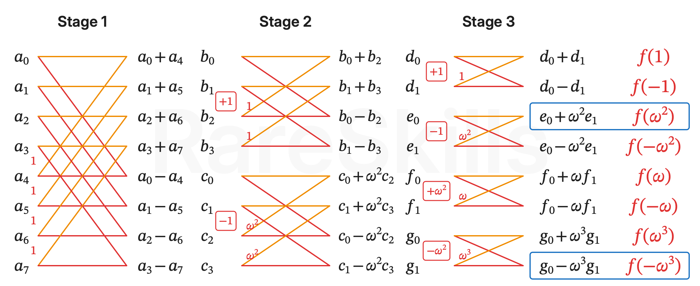
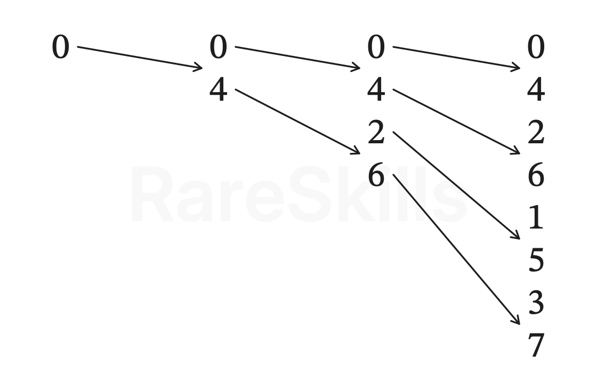
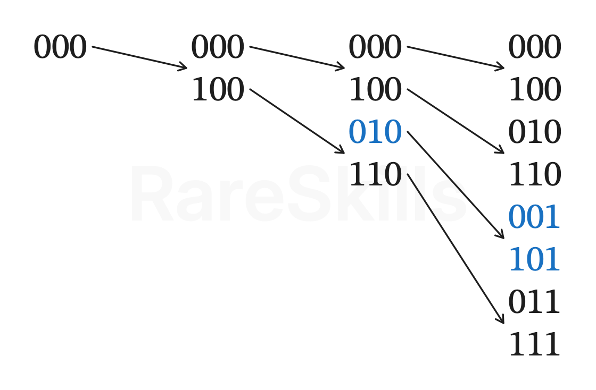
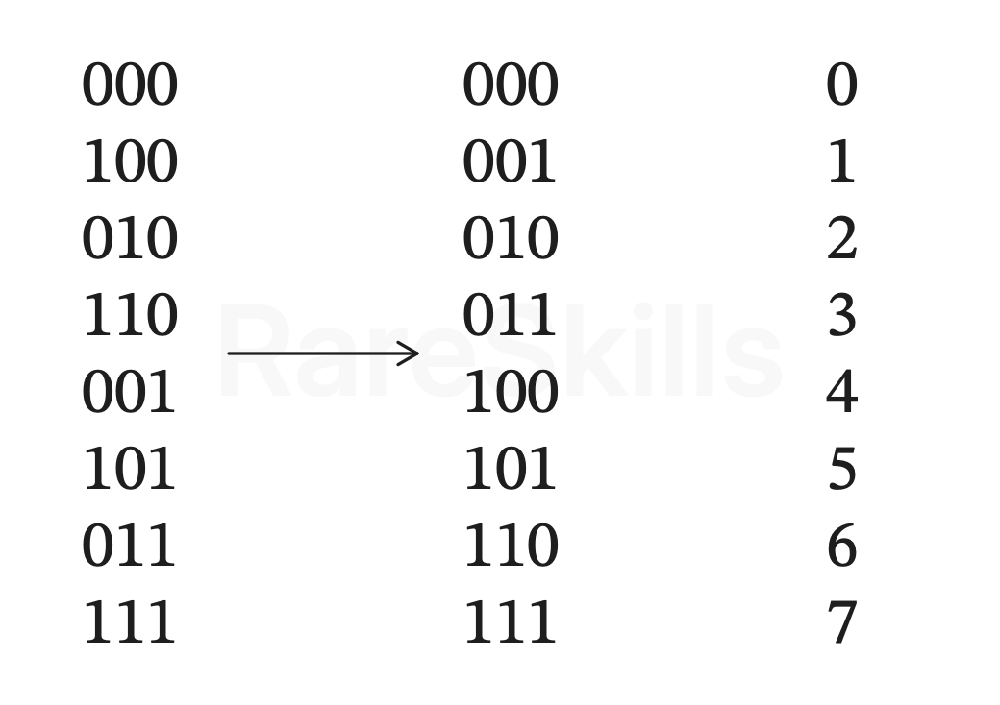
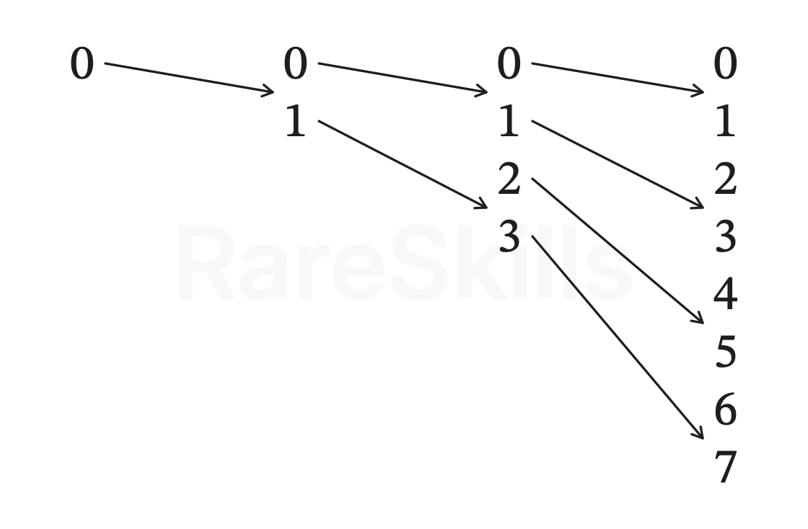

# Decimation-in-Time (DIT) and Decimation-in-Frequency (DIF)

In the context of the NTT, it is common to find two algorithms in the literature: Decimation-in-Time (DIT) and Decimation-in-Frequency (DIF).

The terms "time" and "frequency" are a reminder that the NTT is the finite-field analogue of the Discrete Fourier Transform (DFT), and that its fast algorithms mirror the Fast Fourier Transform (FFT), which operates on complex-valued signals in the time and frequency domains.

The algorithm we developed in the previous chapter is not, strictly speaking, identical to either the DIF or the DIT algorithms found in the literature.

However, it shares an important property with the standard DIF algorithm: the order in which the coefficients enter the algorithm and the order in which the evaluations are produced. For this reason, throughout this series we will refer to it simply as **DIF**.

To recap, our 8-point **DIF** NTT can be constructed using the following SFG:

To construct the above SFG, we followed the same procedure used in the article [*NTT Algorithm by Hand*](https://rareskills.io/post/ntt-by-hand), where we tracked the branches of the innermost square roots.

The input coefficients are arranged as follows. Notice that, in the SFG, the polynomial coefficients $a_0$ through $a_7$ are arranged in their natural order:

$$
a_0,\ a_1,\ a_2,\ a_3,\ a_4,\ a_5,\ a_6,\ a_7
$$

The output, on the other hand, is *not* in natural order. Instead of obtaining

$$
f(\omega^0),\; f(\omega^1),\; f(\omega^2),\;f(\omega^3),\;f(\omega^4),\; f(\omega^5),\; f(\omega^6),\;  f(\omega^7),
$$

we obtain the values in another order:

$$
f(\omega^0),\; f(\omega^4),\; f(\omega^2),\; f(\omega^6),\; f(\omega^1),\; f(\omega^5),\; f(\omega^3),\; f(\omega^7).
$$

The order above is called *bit-reversed order*, and in this chapter, we will explain why.

The DIF has inputs in natural order and outputs in bit-reversed order. The DIT, which we will introduce at the end of this chapter, has inputs in bit-reversed order and outputs in natural order.

Both DIF and DIT can be used to implement the NTT and INTT, so it is possible to use only one of them. However, using them together offers significant practical advantages.

Consider the problem of multiplying two polynomials, where we need to perform both the NTT and the INTT. If we only had the DIF algorithm, the NTT output would be in bit-reversed order. To perform the INTT later, we would first have to convert this output to natural order. Also, the result of the INTT would again need to be converted back to natural order.

The process is illustrated in the following diagram:

By using both DIF and DIT, we avoid any bit-reversal permutation. We simply use the output of the DIF, which is already in bit-reversed order, as the input to the DIT, which expects its input in bit-reversed order. As a bonus, the final output is already in natural order.

The resulting process is illustrated in the following diagram:

As can be seen, the number of steps is smaller. Let us now examine what is meant by bit-reversed order.

## Bit-reversed order

The **bit-reversed order** of a sequence of non-negative integers is obtained by reversing the bits of the binary representation of each integer in the sequence. This is probably best understood through a simple example.

Consider the numbers from $0$ to $3$ in natural order: $0,1,2$, and $3$. Their binary representations are:

$$
\begin{aligned}
00 \\
01 \\
10 \\
11
\end{aligned}
$$

Now reverse the bits of each binary number:

$$
\begin{aligned}
00 \\
10 \\
01 \\
11
\end{aligned}
$$

Converting these binary values back to decimal gives:

$$
0,2,1,3
$$

Therefore, the numbers from 0 to 3 in bit-reversed order are:

$$
0,2,1,3
$$

**Exercise.** Find the numbers from 0 to 7 in bit-reversed order. Compare your result with the output ordering of the 8-point DIF algorithm presented above.

## The order of the output and the twiddle factors

Understanding why the output of the DIF is in bit-reversed order will help us determine the twiddle factors at every stage.

To begin, consider again the 8-point DIF NTT shown below. Notice that the order of the roots of unity at which the polynomial is evaluated exactly matches the twiddle factors in the last stage—that is, the weights assigned to the edges in the last stage.

For example, the last twiddle factor for $f(\omega^2)$ is $\omega^2$. The last twiddle factor for $f(-\omega^3)$ is $-\omega^3$, and so on.

Later in this chapter, we will prove that this is indeed the case. For now, we assume that the twiddle factors in the last stage are the $k$-th roots of unity whose exponents are arranged in bit-reversed order.

A previous exercise asked you to compute the sequence from $0$ to $7$ in bit-reversed order, but let us revisit it here.

The numbers from 0 to 7 in binary are:

$$
\begin{aligned}
0 &= 000 \\
1 &= 001 \\
2 &= 010 \\
3 &= 011 \\
4 &= 100 \\
5 &= 101 \\
6 &= 110 \\
7 &= 111
\end{aligned}
$$

Reversing the bits of each binary representation, we obtain:

$$
\begin{aligned}
000 &\rightarrow 000 \\
001 &\rightarrow 100 \\
010 &\rightarrow 010 \\
011 &\rightarrow 110 \\
100 &\rightarrow 001 \\
101 &\rightarrow 101 \\
110 &\rightarrow 011 \\
111 &\rightarrow 111
\end{aligned}
$$

Converting these reversed binary values back to decimal yields:

$$
0,\;4,\;2,\;6,\;1,\;5,\;3,\;7.
$$

This is exactly the order in which the roots of unity are evaluated in the output of the algorithm above:

$$
[\omega^0, \omega^4,\omega^2, \omega^6, \omega^1, \omega^5, \omega^3, \omega^7],
$$

or, since $\omega$ is a primitive $8$th root of unity, and therefore $\omega^4 \equiv -1$:

$$
[1,-1,\omega^2, -\omega^2, \omega, -\omega, \omega^3, -\omega^3]
$$

In this chapter, we will show that this is the rule for any $k$-point DIF: **the algorithm gives us the evaluations at all the roots of unity, from $\omega^0$ to $\omega^{k-1}$, not in natural order, but in an order where the powers of the roots of unity are in bit-reversed order.**

The same is true for the last twiddle factors. They are exactly the same roots of unity being evaluated. If the evaluation is $f(\omega^a)$, then the last twiddle factor is $\omega^a$.

### All the twiddle factors from the bit-reversed order

Note also that the twiddle factors of the earlier stages are obtained from those of the last stage by taking the first half of the above list at each step.

For example, assume that the twiddle factors of the last stage are

$$
[1,-1,\omega^2, -\omega^2, \omega, -\omega, \omega^3, -\omega^3]
$$

The twiddle factors of stage 2 are (take the first half of the above list)

$$
[1,-1,\omega^2, -\omega^2]
$$

The twiddle factors of stage 1 are (take the first half of the above list)

$$
[1,-1]
$$

That is, at each step we reduce the list of twiddle factors to half of its previous size, proceeding from the last stage toward the first. Therefore, **if we know how to compute the twiddle factors of the last stage, we can compute the twiddle factors of any stage.** This is very helpful for writing an algorithm.

Assuming that the twiddle factors of the last stage are the sequence from $\omega^0$ to $\omega^{k-1}$ in bit-reversed order, we have everything we need to determine the twiddle factors for every stage.

We now show that the twiddle factors of the last stage are indeed the roots of unity in bit-reversed order.

## The twiddle factor pattern (recap)

To recap how the twiddle factors arise, let us return to the algorithm used to compute the NTT by hand. For each innermost square root, we branch into two, and the two branches correspond to the two possible values of that square root.

On the left, the branching is shown from top to bottom; on the right, it is shown from left to right, as in the SFG.

Note that the final order is exactly that of the roots of unity arranged in bit-reversed order:

$$
[\omega^0, \omega^4, \omega^2, \omega^6, \omega^1, \omega^5, \omega^3, \omega^7]
$$

or, taking $\omega^4 \equiv -1$,

$$
[1,-1,\omega^2, -\omega^2, \omega, -\omega, \omega^3, -\omega^3]
$$

The illustration above shows that this property holds for the 8-point DIF NTT, but it does not prove that it holds in general. Let us now prove that it does.

## The branching process

Let's revisit the branching process and how the twiddle factors are generated at each step. It is all based on taking the square root of the current factor.

The pattern for generating the twiddle factors in the $k$-point NTT is as follows:

- The algorithm starts with a single element, $\omega^0=1$.
- At each stage, each element $\omega^q$ branches into its two square roots. Since $q$ is always even at this point (odd exponents appear only in the last stage, as we will see), one square root is $\omega^{q/2}$, and the other is $-\omega^{q/2} \equiv \omega^{k/2}\omega^{q/2} = \omega^{q/2+k/2}$, since $-1 \equiv \omega^{k/2}$ for a primitive $k$-th root of unity $\omega$.
- The elements continue branching until there are $k$ elements, corresponding to $\log_2k$ stages.

Let us verify this pattern in the 8-point NTT, as illustrated above.

- **Stage 1:** We begin with $\omega^0$. Applying the pattern, its two square roots are $\omega^{0/2} = \omega^0$ and $\omega^{0/2 + k/2} = \omega^{4}$. This matches the illustration, which shows the weights as $1$ and $\omega^4$ (which is $-1$).
- **Stage 2:** We now have two elements from the previous stage: $\omega^0$ and $\omega^4$.
    - $\omega^0$ branches into $\omega^{0/2} = \omega^0$ and $\omega^{0/2 + 4} = \omega^4$.
    - $\omega^4$ branches into $\omega^{4/2} = \omega^2$ and $\omega^{4/2 + 4} = \omega^{6}$.
        
        This set of four weights, $\{ \omega^0, \omega^4, \omega^2, \omega^6 \}$, is exactly what the illustration shows for the second stage.
        
- **Stage 3:** The process is repeated with the four elements from Stage 2: $\omega^0, \omega^4, \omega^2, \omega^6$. Their square roots produce the final eight weights. For instance, $\omega^2$ branches into $\omega^{2/2}=\omega^{1}$ and $\omega^{2/2+4} = \omega^5$, which appear in the final stage of the diagram.

For the 8-point NTT, the branching is shown below, where the numbers displayed are the exponents of the roots of unity. For example, $6$ corresponds to $\omega^6$.

Each number $q$ generates two new numbers, which are $q/2$ and $q/2+4$ for the 8-point NTT. 

The 8-point example makes the pattern apparent, but it does not yet explain why the pattern holds for arbitrary $k=2^n$. 

To understand why the final twiddle factor exponents are always the integers from $0$ to $k-1$ in bit-reversed order, we need to analyze the branching process in the binary representation of the numbers.

## The bit reversal pattern in binary

Let us analyze the branching process in the binary representation of the numbers.

Consider the numbers from $0$ to $7$ in binary. They can be represented by 3 bits, $b_2 b_1 b_0$, where $b_0$ is the least significant bit (LSB) and $b_2$ is the most significant bit (MSB).

The main operation in the branching process is taking the square root of a root of unity; in terms of the exponents, this means dividing the exponent by 2.

In the binary representation, dividing by $2$ corresponds to right-shifting the bits.

For example, the number $6$, whose binary representation is $110$, when right-shifted becomes $011$, which is $3$.

Another frequent operation in this pattern is multiplying the square root by $\omega^\frac{k}{2}$, or, in terms of the exponents, adding $\frac{k}{2}$ to the exponent. 

For example, for $k = 8$, $\omega^4$ branches into $\omega^2$ and $\omega^{2+4}$.

For $k=2^n$, adding $k/2$ to a number is straightforward. Since $k/2 = 2^{n-1}$, its $n$-bit representation is $100\ldots00$, that is, $1$ in the MSB and $0$ in all other bits. Moreover, after a right shift the MSB is always $0$, so adding $2^{n-1}$ produces no carry: it simply sets the MSB to $1$.

Let's see what the branching pattern looks like in binary, considering the exponents of the roots of unity:

- Each number becomes two new numbers: for the first, we right-shift the previous number (divide by 2); for the second, we right-shift followed by setting the MSB to $1$.

Let's look at this pattern for $k=8$ in the figure below:

For instance, take the binary number $010$. When branching:

- We right-shift, which generates $001$.
- We right-shift and set the MSB to 1, which generates $101$.

Following this procedure, the end result is

$$
[000,100,010,110,001,101,011,111].
$$

In decimal, this sequence is 

$$
[0,4,2,6,1,5,3,7],
$$

as expected.

At this point, we have not shown anything new; we have simply reproduced what we already knew, but in binary. Things start to get interesting when we take the result of the last step, represent it in binary, and reverse the order of the bits. That is, swap $b_2 b_1 b_0$ with $b_0 b_1 b_2$:

What we obtain is exactly the sequence $0, 1, \dots, 7$ in natural order.

What we will show is that this pattern is always valid, not just for $k=8$. Before that, let us briefly discuss the odd/even relation.

## The odd/even relation

Throughout this series, we have presented the NTT algorithm in a different way from how it is usually presented, which is typically based on the idea of separating odd and even exponents.

We believe that the fundamental building block of the NTT is the branching process, and that the parity relations—the separation of odd and even numbers—are merely a side effect of this process.

In this section, we will briefly show that the branching process always leads to a natural separation between odd and even numbers in the final twiddle factors: the first half is even, while the second half is odd.

The reason is that the first branch of the algorithm for a $k$-point NTT, with $k=2^n$, always produces the two $n$-bit numbers

$$
\underbrace{000\ldots000}_{n\text{ bits}} \qquad\text{and}\qquad \underbrace{100\ldots000}_{n\text{ bits}}.
$$

At each subsequent stage, a right shift moves this $1$ one position to the right. Since a $k$-point NTT has $n=\log_2 k$ stages, this $1$ is shifted $n-1$ times after the first stage, so it reaches the LSB only at the final stage. More generally, a $1$ set in the MSB at stage $j$ ends up at bit $j-1$, so only the $1$ set at stage 1 reaches the LSB. Therefore, only at the last stage can the numbers become odd, since odd numbers have a $1$ in the LSB.

The $1$ reaches the LSB precisely along the branch starting with $100\ldots000$, which is the second branch of the first split and ultimately generates the second half of the final sequence.

For our purposes, this even/odd split is not important; it is merely a curiosity that emerges from the branching process.

## Branching in bit-reversed order

Our goal in this section is to show that the branching process always leads to the final exponents of the roots of unity being the sequence from $0$ to $k-1$ in bit-reversed order.

To achieve this, we will once again examine how the branching process works, but this time from a bit-reversed perspective. We will show that this leads to the natural sequence of non-negative integers.

In a previous section, we saw that the algorithm for generating the exponents for the twiddle factors works as follows:

- Each number branches into two. The first is generated by a right shift, and the second by a right shift followed by setting the MSB to 1.

Now consider what this means in bit reversal:

- When the bits are reversed, a right shift becomes a left shift; therefore, dividing by 2 becomes multiplying by 2.
- When the bits are reversed, the MSB becomes the LSB; therefore, setting the MSB to $1$ becomes setting the LSB to $1$. Since the LSB is always $0$ after a left shift, this is the same as adding $1$.

**We will show that this branching process in bit-reversed order, starting from 0, generates a sequence of consecutive integers from $0$ to $k-1$.**

Consider the sequence below. To generate the next step, we take the previous sequence and, for each element, produce two new ones: one equal to twice the element and the other equal to twice the element plus 1.

Thus, 

- 0 becomes 0 and 1;
- 1 becomes 2 and 3;
- 2 becomes 4 and 5;
- 3 becomes 6 and 7;
- and so on.

You can continue this sequence as far as you want. The sequence generated by “doubling” and “doubling plus 1”, starting from zero, is precisely the sequence of consecutive non-negative integers.

This is equivalent to saying that the sequence created by halving, and halving plus $\frac{k}{2}$, is the sequence of bit-reversed consecutive integers.

Below is an example for the case $k=16$. The first column lists the numbers from 0 to 15 in binary, the second column shows the bits in reverse order, and the third column gives the decimal equivalent of the second column.

| number in binary | bit-reversed in binary | bit-reversed in decimal |
| --- | --- | --- |
| 0000 | 0000 | 0 |
| 0001 | 1000 | 8 |
| 0010 | 0100 | 4 |
| 0011 | 1100 | 12 |
| 0100 | 0010 | 2 |
| 0101 | 1010 | 10 |
| 0110 | 0110 | 6 |
| 0111 | 1110 | 14 |
| 1000 | 0001 | 1 |
| 1001 | 1001 | 9 |
| 1010 | 0101 | 5 |
| 1011 | 1101 | 13 |
| 1100 | 0011 | 3 |
| 1101 | 1011 | 11 |
| 1110 | 0111 | 7 |
| 1111 | 1111 | 15 |

Therefore, the final twiddle factors for the 16-point NTT DIF are 

$$
[\omega^0,\ \omega^8,\ \omega^4,\ \omega^{12},\ \omega^2,\ \omega^{10},\ \omega^6,\ \omega^{14},\ \omega^1,\ \omega^9,\ \omega^5,\ \omega^{13},\ \omega^3,\ \omega^{11},\ \omega^7,\ \omega^{15}].
$$

**In the end, the final idea is simple: to find the final twiddle-factor exponents (and the final evaluation order) of the $k$-th roots of unity in DIF, write the numbers from $0$ to $k-1$ in binary and reverse the order of the bits. Convert the reversed bits back to decimal, and that is the order you are looking for.**

## The NTT Decimation-in-Time

The NTT using DIF receives as input the coefficients of the polynomial in the so-called natural order, $[a_0, a_1, \dots, a_{k-1}]$, and outputs the evaluations at the $k$-th roots of unity in bit-reversed order, $[f(\omega^0), f(\omega^\frac{k}{2}),\dots, f(\omega^{k-1})]$.

Alternatively, we can construct an SFG whose inputs are the coefficients in bit-reversed order. Unlike the DIF algorithm, this arrangement produces the output in natural order. This variant is known as the **Decimation-in-Time (DIT) algorithm.**

An SFG for an 8-point **DIT** NTT is shown below. In the next chapter, we will show how to construct this SFG and implement the corresponding algorithm.

**The evaluation results at the roots of unity are exactly the same for both algorithms—the only difference in the result is the ordering of the input and output.** The main difference in the algorithm lies in how we construct the SFG and, consequently, in how we translate it into code or pseudocode.

In this 8-point DIT, the input is the vector of coefficients in bit-reversed order,

$$
[a_0, a_4, a_2, a_6, a_1, a_5, a_3, a_7],
$$

and the output is the vector of evaluations at the roots of unity in natural order,

$$
[f(\omega^0), f(\omega^1),f(\omega^2),f(\omega^3),f(\omega^4),f(\omega^5),f(\omega^6),f(\omega^7)]
$$

In the next chapter, we will implement in Python the standard DIT algorithm used in the FFT literature.